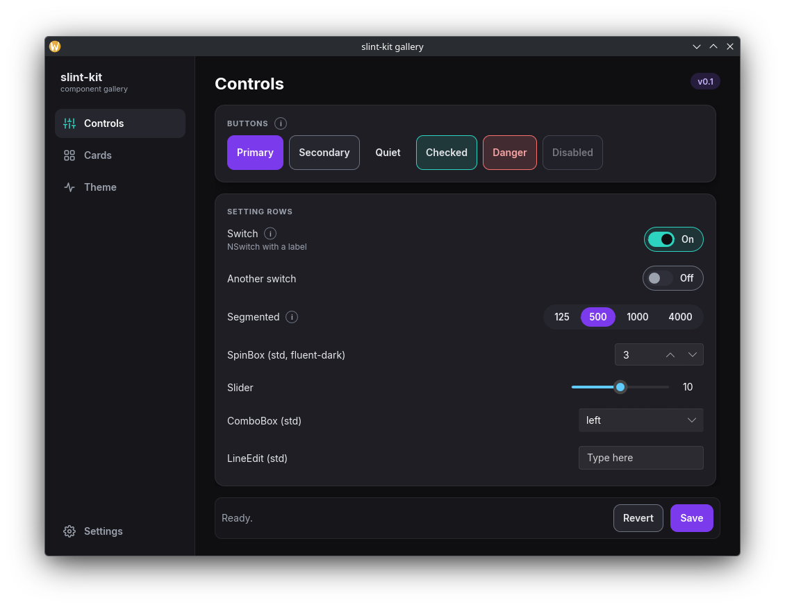

# Kaamos

Kaamos (Finnish for the polar night) is a dark Slint UI kit and Linux desktop helpers for Rust apps,
extracted from NARME and PulsarFe. Slint 1.18.



## What is in it

| Crate | Use as | Contents |
|---|---|---|
| `kaamos-ui` | build-dependency | `@kaamos/kaamos.slint`: `Theme`, `NButton`, `NSwitch`, `Segmented`, `Card`, `Caps`, `Chip`, `NavItem`, `ValueField`, `Dialog`, `SettingRow`, `Section`, `Stat`, `PageTitle`, `Hint`, `InfoTip` + `InfoLayer`; Inter font, icons |
| `kaamos` | dependency | `platform::init` (Wayland app id + activation token), `tray` (ksni tray icon; `TrayStatus::online` says whether a panel shows it), `autostart`, `paths` (XDG), `poll` (worker thread → UI) |

The Linux helpers fix problems that a plain Slint app has on KDE Plasma (Wayland):

- the task bar shows the window and the launcher separately, plus an empty "starting" entry
  → `platform::init(app_id)` sets the app id and uses the activation token;
- Slint's `SystemTrayIcon` creates an extra empty window → `tray` uses ksni instead;
- tooltips with custom content get a wide grey frame and popups break hover → `InfoTip` +
  `InfoLayer` draw the explanation as an overlay.

## Use in a project

```toml
[dependencies]
slint = { version = "~1.18.1", features = ["unstable-winit-030"] }
kaamos = { git = "https://github.com/Hamsteri777/kaamos", tag = "v0.4.0" }

[build-dependencies]
slint-build = "~1.18.1"
kaamos-ui = { git = "https://github.com/Hamsteri777/kaamos", tag = "v0.4.0" }
```

```rust
// build.rs
let config = slint_build::CompilerConfiguration::new()
    .with_style("fluent-dark".into())
    .with_library_paths(kaamos_ui::library_paths());
slint_build::compile_with_config("ui/main.slint", config).unwrap();
```

```slint
import { Theme, NButton, Section, SettingRow, InfoLayer } from "@kaamos/kaamos.slint";

export component MainWindow inherits Window {
    background: Theme.bg;
    default-font-family: "Inter";
    Section {
        title: "SETTINGS";
        SettingRow { label: "Debounce"; info-body: "What it does…"; /* control */ }
    }
    InfoLayer { }   // last child: draws the (i) explanations on top
}
```

```rust
slint::include_modules!(); // the components compiled by build.rs

fn main() -> Result<(), slint::PlatformError> {
    kaamos::platform::init("my-app")?; // = the .desktop file name
    let ui = MainWindow::new()?;
    ui.run()
}
```

Kaamos is a public git dependency, so no credentials are needed. If your git config rewrites
GitHub URLs (e.g. to SSH), let cargo use the git CLI: `.cargo/config.toml` →
`[net] git-fetch-with-cli = true` (the template does this).

## Start a new app

```bash
./new-project.sh my-app "My App" ~/projects/my-app
cd ~/projects/my-app && ./check.sh && cargo run
```

The template has a sidebar with pages, a Save / Revert bar, (i) infos, a worker thread, a tray
(Show / Quit), `--tray`, start at login, an Arch `PKGBUILD`, `check.sh` and a `CLAUDE.md`.

## Gallery and checks

```bash
cargo run -p kaamos-gallery
./check.sh
```

## Licence

Copyright (C) 2026 Hamsteri777. GPL-3.0-or-later ([LICENSE](LICENSE)). Inter font: OFL-1.1; Feather-based icons: MIT; see
[THIRD_PARTY_NOTICES](THIRD_PARTY_NOTICES).
